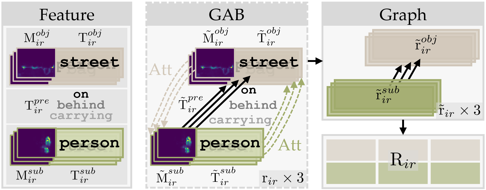
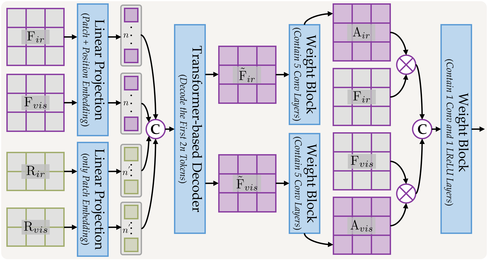

# GraTIR
[](https://www.sciencedirect.com/journal/information-fusion)
[](https://github.com/lok-18/IGNet/blob/master/LICENSE)
[](https://www.python.org/)
[](https://pytorch.org/)

### Focusing on Object Relations in Scenes: A Multi-collaborative Graph-structured Framework for Infrared and Visible Image Fusion
in Information Fusion (**Inf Fus**) 🔥🔥🔥

by [Jiawei Li](https://scholar.google.com.hk/citations?user=xWy8RZEAAAAJ&hl=zh-CN), [Hongwei Yu](https://scholar.google.com.hk/citations?hl=zh-CN&user=cDidt64AAAAJ), [Xinlong Ding](https://scholar.google.com.hk/citations?user=JY9oXVIAAAAJ&hl=zh-CN&oi=ao), [Enlong Wang](https://scholar.google.com.hk/citations?user=yW520ooAAAAJ&hl=zh-CN&oi=ao), [Qiankun Liu](https://scholar.google.com.hk/citations?user=TNDbzzMAAAAJ&hl=zh-CN&oi=ao), [Jinyuan Liu](https://scholar.google.com.hk/citations?user=a1xipwYAAAAJ&hl=zh-CN&oi=ao), [Huimin Ma](https://scholar.google.com.hk/citations?user=32hwVLEAAAAJ&hl=zh-CN&oi=ao), and [Jiansheng Chen](https://scholar.google.com.hk/citations?user=A1gA9XIAAAAJ&hl=zh-CN&oi=ao)
- [[*Elsevier*]]()


PyTorch implementation of **GraTIR**, a framework for infrared and visible image fusion with **text–image–relation collaborative representation**. GraTIR combines visual features with scene graph descriptions to preserve both image details and relationships among objects. The manuscript evaluates fusion quality, object detection, semantic segmentation, and scene graph generation.

### 🔍 Framework


The framework consists of three main components:

- **Scene Graph Generation (SGG):** a pretrained RelTR model extracts subject–predicate–object triplets and corresponding attention maps from each source modality. The top three predictions are selected for relation feature construction.
- **Relation-to-Graph (R2G):** CLIP text embeddings and attention-derived visual features form graph representations that capture interactions between subjects and objects.
- **Global Adaptive Decoder (GAD):** visual and relation features are decoded together to produce adaptive fusion weights. Scene graph supervision further guides the fine-tuning stage.

<p align="center">
  
  
</p>

*Framework, R2G, and GAD illustrations are Figures 3, 5, and 6 of the manuscript.*

### ‼️ Requirements

The environment versions follow [SCSFusion](https://github.com/lok-18/SCSFusion):

> - python 3.10
> - torch 1.13.0
> - torchvision 0.14.0
> - opencv 4.9
> - numpy 1.26.4
> - pillow 10.3.0

Run all commands below from the **GraTIR repository root**, because model and data paths are relative to this directory. `RelTR/` is included as source code within this repository; no separate clone is required.

### 📦 Pretrained Models

Prepare the following files before testing or training:

| Model | Expected local path | Source |
| --- | --- | --- |
| GraTIR fusion model | `checkpoint/model.pth` | Obtain the trained fusion checkpoint from the authors, or generate it with `train.py`. A public download link is not currently included in this repository. |
| RelTR pretrained on Visual Genome | `RelTR/ckpt/checkpoint0149.pth` | [Official RelTR checkpoint](https://drive.google.com/file/d/1id6oD_iwiNDD6HyCn2ORgRTIKkPD3tUD/view), linked by the [RelTR repository](https://github.com/yrcong/RelTR). |
| CLIP ViT-B/16 | `clip_model/pytorch_model.bin` | [openai/clip-vit-base-patch16](https://huggingface.co/openai/clip-vit-base-patch16). Configuration and tokenizer files are already included in `clip_model/`. |

**Model weights are excluded from Git.** Cloning the repository does not download these files. Training requires the RelTR and CLIP weights; testing additionally requires the trained GraTIR checkpoint.

To download the CLIP model and processor into the expected directory, run:

```python
from transformers import CLIPModel, CLIPProcessor

model_id = "openai/clip-vit-base-patch16"
CLIPModel.from_pretrained(model_id).save_pretrained(
    "./clip_model", safe_serialization=False
)
CLIPProcessor.from_pretrained(model_id).save_pretrained("./clip_model")
```

The torchvision ResNet-50 backbone may also download its pretrained weights on first use. Prepare its local cache in advance when running offline.

### 📑 Dataset Setting

Example infrared/visible image pairs from **M3FD** and **MSRS** are included in `test_images/`. Additional data are available from the original projects:

- **[M3FD / TarDAL](https://github.com/JinyuanLiu-CV/TarDAL):** infrared/visible image pairs with object detection annotations, plus a separate fusion subset.
- **[MSRS / SeAFusion](https://github.com/Linfeng-Tang/SeAFusion):** infrared/visible image pairs with semantic segmentation annotations. The manuscript uses MSRS for fusion model training.

Arrange your own test images as follows:

```text
test_images/
├── ir/
│   ├── 1.png
│   ├── 2.png
│   └── ...
└── vis/
    ├── 1.png
    ├── 2.png
    └── ...
```

Use registered image pairs with matching filenames, image counts, and spatial dimensions. Visible images should be RGB. The loader pairs files by sorted order and supports `.bmp`, `.tif`, `.jpg`, and `.png`; keep the directories free of unrelated files. The current decoder uses 16 × 16 patches, so use image dimensions divisible by 16.

**IVIF-SG.** The manuscript introduces a scene graph benchmark containing **300 image pairs**: 88 from M3FD and 212 from MSRS. Each scene has 10 manually verified relations, covering 55 subject/object categories and 20 predicate categories. Download the dataset from **[Google Drive](https://drive.google.com/file/d/1_N6iiYf70_uSkmJVl9IyLFsCdIF6PgQJ/view?usp=sharing)**.

### 🖥️ Test

After preparing the three models and paired images, run:

```bash
python test.py
```

The default paths are:

| Setting | Path |
| --- | --- |
| Fusion checkpoint | `./checkpoint/model.pth` |
| Infrared images | `./test_images/ir/` |
| Visible images | `./test_images/vis/` |
| Fused results | `./results/test/` |

The script fuses the luminance channel and combines it with the visible image's chrominance channels to save RGB results with the input filenames:

```text
results/
└── test/
    ├── 1.png
    ├── 2.png
    └── ...
```

Change `fusion_model_path`, `ir_path`, `vis_path`, or `fused_dir` in `test.py` to use different locations. Testing defaults to batch size 1 and sets `CUDA_VISIBLE_DEVICES` to `0` inside the script.

Use the command above without additional flags: the current backbone parses command-line arguments separately, so options exposed by `test.py`, such as `--batch_size` or `--gpu`, are not accepted by both parsers. Adjust the script defaults when needed.

### ⌛ Train

Before training:

1. Download the MSRS training images and prepare the RelTR and CLIP weights.
2. Set `ir_path` and `vis_path` in `train.py` to your training directories. The existing paths point to the author's local filesystem.
3. Set the `CUDA_VISIBLE_DEVICES` assignment in `train.py` to an available GPU. Its current value is `7`; on a single-GPU machine, change it to `0`. The assignment inside the script overrides an external setting.

Then run:

```bash
python train.py
```

The script performs fusion training followed by scene graph fine-tuning, writes logs to `logs/`, and saves the final model as `checkpoint/model.pth`.

The initial fusion objective implemented in `loss.py` is:

```text
L_fusion = L_intensity + 10 × L_gradient + 0.5 × L_SSIM
```

The intensity term compares the fused image with the mean source intensity, the gradient term preserves the stronger source gradients, and the SSIM term encourages structural similarity to both inputs.

**Code defaults and manuscript settings:**

| Setting | Current `train.py` | Manuscript, Section 4.2 |
| --- | --- | --- |
| Optimizer | Adam | Adam |
| Initial training learning rate | `1e-3` | `1e-3` |
| Training batch size | 4 | 4 |
| Training epochs | 10 | 100 |
| Initial fine-tuning learning rate | `1e-4` | `1e-4` |
| Fine-tuning batch size | 2 | 2 |
| Fine-tuning epochs | 5 | 50 |
| Learning rate decay | `lr_start × 0.75 ** (epo - 1)`, updated every epoch | Decay rate 0.75, stride 8 |

For manuscript reproduction, align the training configuration with the paper. In addition to the settings above, Algorithm 1 uses a joint fusion and scene graph objective during fine-tuning, while the current second stage uses `SGGFinetuneLoss` alone. The manuscript also keeps the pretrained SGG model frozen, whereas the current optimizer receives all `train_model.parameters()` without explicitly freezing the SGG parameters. These differences should be addressed before claiming reproduction of the reported results.

### 🌟 Experimental Results

The following figures and values are taken from the manuscript. They are reported paper results, rather than measurements produced by running this checkout.

#### Image Fusion

GraTIR is compared with 14 methods: ReFusion, FusionBooster, WoReg, CoCoNet, MulFS, TIMFusion, LRRNet, MURF, GIFNet, EMMA, TCMoA, TextDiFuse, FusionINV, and DiTFuse.


GraTIR scores from Table 2 are shown below. ↑ indicates higher is better; ↓ indicates lower is better.

| Dataset | AG ↑ | CC ↑ | SCD ↑ | MSE ↓ |
| --- | ---: | ---: | ---: | ---: |
| M3FD | 6.176 | 0.627 | 1.730 | 0.027 |
| MSRS | 3.803 | 0.652 | 1.710 | 0.022 |

#### Object Detection

The manuscript evaluates detection with YOLOv5 on fused images from M3FD and LLVIP.


| Dataset | Metric | GraTIR | Paper table |
| --- | --- | ---: | --- |
| M3FD | mAP@0.5 | 0.823 | Table 3 |
| LLVIP | AP@0.5 | 0.689 | Table 4 |
| LLVIP | AP@0.75 | 0.527 | Table 4 |

#### Semantic Segmentation

The manuscript evaluates segmentation with DeepLabV3+ on MSRS and FMB.


| Dataset | Metric | GraTIR | Paper table |
| --- | --- | ---: | --- |
| MSRS | mIoU | 0.582 | Table 5 |
| FMB | mIoU | 0.436 | Table 6 |

#### Scene Graph Generation

IVIF-SG evaluates whether fused images preserve meaningful relationships among objects, complementing detection and segmentation evaluation.


| Dataset | mR@20 ↑ | mR@50 ↑ | Paper table |
| --- | ---: | ---: | --- |
| IVIF-SG | 0.226 | 0.267 | Table 7 |

The current root-level scripts provide fusion training and inference. The complete downstream evaluation pipelines used for the reported comparisons are not included. Download IVIF-SG separately using the link in [Dataset Setting](#-dataset-setting), and refer to the paper for evaluation protocols and further ablation studies.

### 🗒️ Citation

If this work is useful for your research, please cite the manuscript:

```bibtex
@misc{li2026gratir,
  title={Focusing on Object Relations in Scenes: A Multi-collaborative Graph-structured Framework for Infrared and Visible Image Fusion},
  author={Li, Jiawei and Yu, Hongwei and Ding, Xinlong and Wang, Enlong and Liu, Qiankun and Liu, Jinyuan and Ma, Huimin and Chen, Jiansheng},
  year={2026},
  note={Manuscript},
  url={https://github.com/lok-18/GraTIR}
}
```

### 🧩 Related Work

1. Jiawei Li, Jiansheng Chen, Jinyuan Liu and Huimin Ma. **Learning a Graph Neural Network with Cross Modality Interaction for Image Fusion** [C]. Proceedings of the 31st ACM International Conference on Multimedia, 2023: 4471–4479. <a href="https://dl.acm.org/doi/10.1145/3581783.3612135"><em>[Paper]</em></a> <a href="https://github.com/lok-18/IGNet"><em>[Code]</em></a>

2. Jiawei Li, Hongwei Yu, Jiansheng Chen, Xinlong Ding, Jinlong Wang, Jinyuan Liu, Bochao Zou and Huimin Ma. **A²RNet: Adversarial Attack Resilient Network for Robust Infrared and Visible Image Fusion** [C]. Proceedings of the AAAI Conference on Artificial Intelligence, 2025, 39(5): 4770–4778. <a href="https://ojs.aaai.org/index.php/AAAI/article/view/32504"><em>[Paper]</em></a> <a href="https://github.com/lok-18/A2RNet"><em>[Code]</em></a>

3. Hongwei Yu, Daoqing Zha, Jiawei Li\*, Yancheng Bai, Lei Sun and Xiangxiang Chu. **Hybrid Reinforcement Learning for One-step Degraded Infrared and Visible Image Fusion** [C]. Advances in Neural Information Processing Systems, 2026. <a href="https://yuhongwei22.github.io/onehrl-site/"><em>[Project]</em></a>

4. Jiawei Li, Jiansheng Chen, Jinyuan Liu, Hongwei Yu, Xinlong Ding and Huimin Ma. **Multi-Scale Spatial Channel Joint Representation for General Multi-Modality Image Fusion With Self-Supervision** [J]. IEEE Transactions on Multimedia, 2026, 28: 2705–2718. <a href="https://ieeexplore.ieee.org/abstract/document/11329495"><em>[Paper]</em></a> <a href="https://github.com/lok-18/SCSFusion"><em>[Code]</em></a>

5. Jiawei Li, Jinyuan Liu, Shihua Zhou, Qiang Zhang and Nikola K. Kasabov. **GeSeNet: A General Semantic-Guided Network With Couple Mask Ensemble for Medical Image Fusion** [J]. IEEE Transactions on Neural Networks and Learning Systems, 2024, 35(11): 16248–16261. <a href="https://ieeexplore.ieee.org/document/10190200"><em>[Paper]</em></a> <a href="https://github.com/lok-18/GeSeNet"><em>[Code]</em></a>

### 🙇 Acknowledgements

We thank the authors of **[RelTR](https://github.com/yrcong/RelTR)** for their scene graph generation implementation, **[CLIP](https://github.com/openai/CLIP)** for the pretrained vision-language model, and the **[M3FD](https://github.com/JinyuanLiu-CV/TarDAL)** and **[MSRS](https://github.com/Linfeng-Tang/SeAFusion)** teams for their datasets.

### 📬 Contact

Contact **Jiawei Li** at **[ljw19970218@163.com](mailto:ljw19970218@163.com)**, or [open an issue](https://github.com/lok-18/GraTIR/issues) for questions about the project.
