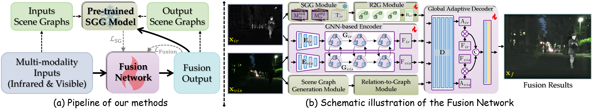
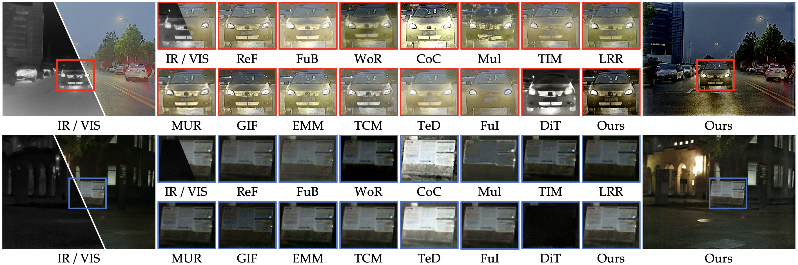
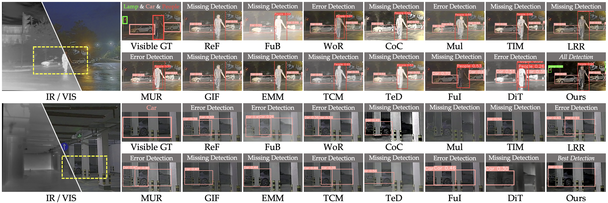
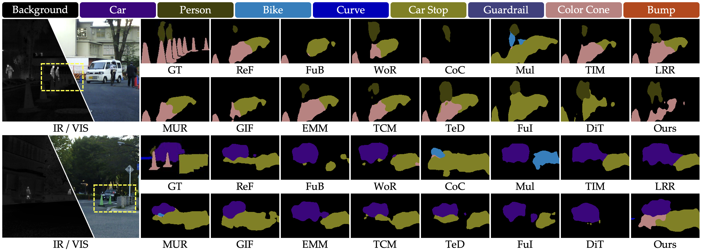
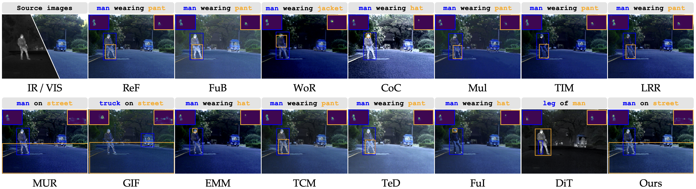

# GraTIR
[](https://www.sciencedirect.com/journal/information-fusion)
[](https://github.com/lok-18/IGNet/blob/master/LICENSE)
[](https://www.python.org/)
[](https://pytorch.org/)
### Focusing on Object Relations in Scenes: A Multi-collaborative Graph-structured Framework for Infrared and Visible Image Fusion
in Information Fusion (**Inf Fus**) 🔥🔥🔥

by [Jiawei Li](https://scholar.google.com.hk/citations?user=xWy8RZEAAAAJ&hl=zh-CN), [Hongwei Yu](https://scholar.google.com.hk/citations?hl=zh-CN&user=cDidt64AAAAJ), [Xinlong Ding](https://scholar.google.com.hk/citations?user=JY9oXVIAAAAJ&hl=zh-CN&oi=ao), [Enlong Wang](https://scholar.google.com.hk/citations?user=yW520ooAAAAJ&hl=zh-CN&oi=ao), [Qiankun Liu](https://scholar.google.com.hk/citations?user=TNDbzzMAAAAJ&hl=zh-CN&oi=ao), [Jinyuan Liu](https://scholar.google.com.hk/citations?user=a1xipwYAAAAJ&hl=zh-CN&oi=ao), [Huimin Ma](https://scholar.google.com.hk/citations?user=32hwVLEAAAAJ&hl=zh-CN&oi=ao), and [Jiansheng Chen](https://scholar.google.com.hk/citations?user=A1gA9XIAAAAJ&hl=zh-CN&oi=ao)
- [[*Elsevier*]]()
### 🔍 Framework

### ‼️ Requirements
> - python 3.10
> - torch 1.13.0
> - torchvision 0.14.0
> - opencv 4.9
> - numpy 1.26.4
> - pillow 10.3.0
### 📦 Pretrained Models

Prepare the following files before testing or training:

| Model | Expected local path | Source |
| --- | --- | --- |
| GraTIR fusion model | `checkpoint/model.pth` | [model](https://drive.google.com/file/d/16GQ2_PJ_ffmou4-pH54mE3SDz9Rvg3qh/view?usp=sharing) |
| RelTR pretrained on Visual Genome | `RelTR/ckpt/checkpoint0149.pth` | [Official RelTR checkpoint](https://drive.google.com/file/d/1id6oD_iwiNDD6HyCn2ORgRTIKkPD3tUD/view), linked by the [RelTR repository](https://github.com/yrcong/RelTR). |
| CLIP ViT-B/16 | `clip_model/pytorch_model.bin` | [openai/clip-vit-base-patch16](https://huggingface.co/openai/clip-vit-base-patch16). Configuration and tokenizer files are already included in `clip_model/`. |

**Model weights are excluded from Git.** Cloning the repository does not download these files. Training requires the RelTR and CLIP weights; testing additionally requires the trained GraTIR checkpoint.

To download the CLIP model and processor into the expected directory, run:

```python
from transformers import CLIPModel, CLIPProcessor

model_id = "openai/clip-vit-base-patch16"
CLIPModel.from_pretrained(model_id).save_pretrained(
    "./clip_model", safe_serialization=False
)
CLIPProcessor.from_pretrained(model_id).save_pretrained("./clip_model")
```

The torchvision ResNet-50 backbone may also download its pretrained weights on first use. Prepare its local cache in advance when running offline.

### 📑 Dataset Setting

Example infrared/visible image pairs from **M3FD** and **MSRS** are included in `test_images/`. Additional data are available from the original projects:

- **[M3FD / TarDAL](https://github.com/JinyuanLiu-CV/TarDAL):** infrared/visible image pairs with object detection annotations, plus a separate fusion subset.
- **[MSRS / SeAFusion](https://github.com/Linfeng-Tang/SeAFusion):** infrared/visible image pairs with semantic segmentation annotations. The manuscript uses MSRS for fusion model training.

Arrange your own test images as follows:

```text
test_images/
├── ir/
│   ├── 1.png
│   ├── 2.png
│   └── ...
└── vis/
    ├── 1.png
    ├── 2.png
    └── ...
```
**IVIF-SG.** The manuscript introduces a scene graph benchmark containing **300 image pairs**: 88 from M3FD and 212 from MSRS. Each scene has 10 manually verified relations, covering 55 subject/object categories and 20 predicate categories. Download the dataset from **[Google Drive](https://drive.google.com/file/d/1_N6iiYf70_uSkmJVl9IyLFsCdIF6PgQJ/view?usp=sharing)**.

### 🖥️ Test

After preparing the three models and paired images, run:

```bash
python test.py
```
### ⌛ Train
Run:

```bash
python train.py
```
### 🌟 Experimental Results

#### Image Fusion

#### Object Detection

#### Semantic Segmentation

#### Scene Graph Generation

### 🗒️ Citation

If this work is useful for your research, please cite the manuscript:

```bibtex
Please waiting...
```

### 🧩 Related Work

- Jiawei Li, Jiansheng Chen, Jinyuan Liu and Huimin Ma. **Learning a Graph Neural Network with Cross Modality Interaction for Image Fusion** [C]. Proceedings of the 31st ACM International Conference on Multimedia, 2023: 4471–4479. <a href="https://dl.acm.org/doi/10.1145/3581783.3612135"><em>[Paper]</em></a> <a href="https://github.com/lok-18/IGNet"><em>[Code]</em></a>
- Jiawei Li, Hongwei Yu, Jiansheng Chen, Xinlong Ding, Jinlong Wang, Jinyuan Liu, Bochao Zou and Huimin Ma. **A²RNet: Adversarial Attack Resilient Network for Robust Infrared and Visible Image Fusion** [C]. Proceedings of the AAAI Conference on Artificial Intelligence, 2025, 39(5): 4770–4778. <a href="https://ojs.aaai.org/index.php/AAAI/article/view/32504"><em>[Paper]</em></a> <a href="https://github.com/lok-18/A2RNet"><em>[Code]</em></a>
- Hongwei Yu, Daoqing Zha, Jiawei Li\*, Yancheng Bai, Lei Sun and Xiangxiang Chu. **Hybrid Reinforcement Learning for One-step Degraded Infrared and Visible Image Fusion** [C]. Advances in Neural Information Processing Systems, 2026. <a href="https://yuhongwei22.github.io/onehrl-site/"><em>[Project]</em></a>
- Jiawei Li, Jiansheng Chen, Jinyuan Liu, Hongwei Yu, Xinlong Ding and Huimin Ma. **Multi-Scale Spatial Channel Joint Representation for General Multi-Modality Image Fusion With Self-Supervision** [J]. IEEE Transactions on Multimedia, 2026, 28: 2705–2718. <a href="https://ieeexplore.ieee.org/abstract/document/11329495"><em>[Paper]</em></a> <a href="https://github.com/lok-18/SCSFusion"><em>[Code]</em></a>
- Jiawei Li, Jinyuan Liu, Shihua Zhou, Qiang Zhang and Nikola K. Kasabov. **GeSeNet: A General Semantic-Guided Network With Couple Mask Ensemble for Medical Image Fusion** [J]. IEEE Transactions on Neural Networks and Learning Systems, 2024, 35(11): 16248–16261. <a href="https://ieeexplore.ieee.org/document/10190200"><em>[Paper]</em></a> <a href="https://github.com/lok-18/GeSeNet"><em>[Code]</em></a>

### 🙇 Acknowledgements

We thank the authors of **[RelTR](https://github.com/yrcong/RelTR)** for their scene graph generation implementation, **[CLIP](https://github.com/openai/CLIP)** for the pretrained vision-language model, and the **[M3FD](https://github.com/JinyuanLiu-CV/TarDAL)** and **[MSRS](https://github.com/Linfeng-Tang/SeAFusion)** teams for their datasets.

### 📬 Contact

Contact **Jiawei Li** at **[ljw19970218@163.com](mailto:ljw19970218@163.com)**, or [open an issue](https://github.com/lok-18/GraTIR/issues) for questions about the project.
